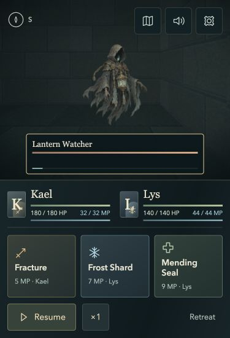

# The Glass Below

An original first-person dungeon RPG for phones, tablets and desktop browsers. TypeScript strict mode, Vite and a small WebGL renderer; no game server, account or telemetry.

## Prototype 0.4

Explore the Glass Crypts, find the copper key, unlock the eastern gate and defeat the Faceless Warden. The hand-built level includes alternative paths, six encounters, a chest, a restorative spring and a final exit. Illustrated creatures stand inside a true 3D environment and are hidden correctly by walls.

Kael and Lys attack automatically. Fracture, Frost Shard and Mending Seal remain manual. Tactical pause freezes combat and lets you queue one skill per hero. Targeting, interrupts, freezing and combat speed ×1 / ×2 are supported.

- Three original illustrated creatures, five poses each.
- Four short, thin blade-stroke variants with small sparks, plus distinct ice, healing, fracture and enemy-hit effects.
- Individually cropped creature poses and combat framing that keeps singles and pairs above a compact enemy-information dock.
- Animated spell particles, damage numbers, hit reactions and camera feedback.
- Eleven original sound effects and three original looping scores: exploration, combat and boss.
- Global mute, independent music/effect levels, background suspension and iOS-friendly OGG/AAC fallback.
- Fully English interface; level title fades after entry, other notices expire, objectives live in the map/menu.
- Portrait and landscape phone layouts with touch targets of at least 44 px, plus wide tablet/desktop layouts.
- Local versioned saves, validated export/import, and offline PWA after the first complete online visit.

The working title is independent of Hollow Oath. Hollow Oath informed the illustrated style and combat rhythm; Dinosaur Resurrection informed only the exploration perspective. No artwork or music from either game is included.

## Play

[Play The Glass Below](https://girianshiido.github.io/the-glass-below/)

For a self-contained offline copy, open `release/The-Glass-Below.html` in a recent browser. It embeds the artwork and both audio codecs. Sound starts after a user gesture. Installation as a PWA requires an HTTPS deployment.

## Development

Node.js 24 and pnpm 10 are recommended.

```sh
pnpm install --frozen-lockfile
pnpm dev
pnpm test
pnpm build
```

The production build runs strict TypeScript checks, compiles into `dist/`, creates the offline cache and packages the standalone HTML. Browser code is in `src/`; authoring scripts are in `scripts/`. The Python audio-authoring script requires numpy and ffmpeg; neither is needed to play or build the game normally. All graphics, sound effects and scores are local files.

| Action | Keyboard |
| --- | --- |
| Forward / backward | W or Z / S, or Up / Down |
| Turn left / right | Left / Right |
| Step sideways | A or Q / D |
| Interact | E |
| Map | M |
| Pause / resume | Space |
| Fracture / Frost Shard / Mending Seal | 1 / 2 / 3 |
| Next living target | Tab |

While paused, selecting a skill queues it; selecting it again cancels it. A new order replaces that hero’s previous order. MP is spent at execution after resuming, with a 0.65-second interval between skills. Combat effects freeze too; the music is ducked. Opening the map or menu pauses combat and does not resume it automatically.

Victory restores 18 HP and 10 MP per hero. The spring fully restores the group once. Retreat preserves current HP and MP but resets undefeated enemies. Saves retain the checkpoint at the start of a fight and update after victory. The original save key and version remain compatible with prototype 0.1; the menu can import its exported saves.

## GitHub Pages

`.github/workflows/deploy.yml` runs the tests, builds, and deploys `dist/` on pushes to `main`. Pages must use **GitHub Actions** as its source. Relative paths support deployment beneath `/the-glass-below/`. The service worker scopes its cache by URL path and never resets player progress.

## Verification

The 32 automated tests cover world connectivity and gate requirements, a complete expedition, combat pause, queued actions, cooldowns, interrupts, targeting, save validation, transient captions, impact projection, all fifteen creature-frame bounds, single/pair framing across phone and desktop sizes, thin impact strokes, codec fallback, music transitions, duplicate playback prevention, mute and background audio handling. Audio assets are also independently probed for valid codecs and duration.

Browser layout checks cover iPhone-sized portrait/landscape views, a large tablet and desktop. Real-device Safari audio behavior, performance and PWA installation still require physical-device checks.

The corrected 375 × 550 portrait combat view:



## Original assets

`public/art/bestiary.png` contains five poses for each of three creatures; `src/creature-frames.ts` records their individual crop coordinates. `public/art/impacts.png` provides the ice and healing spell illustrations; physical hits are drawn with Canvas 2D strokes in `src/impact-art.ts`. Music and effects were composed/synthesized for this project by `scripts/compose-audio.py`; `public/audio/manifest.json` records exact loop durations and audio levels. Architectural textures, lighting, particles and app icons are generated by code.
