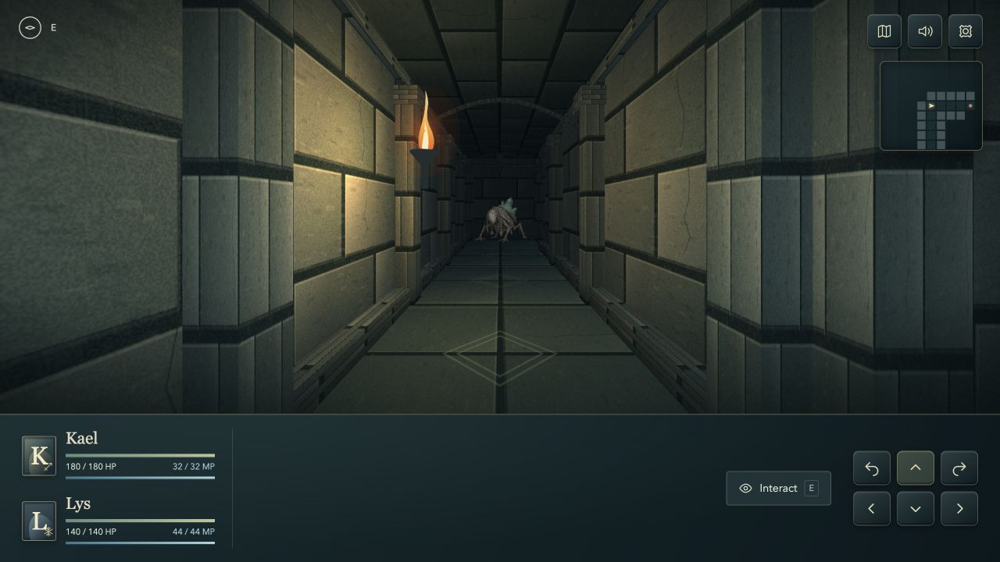
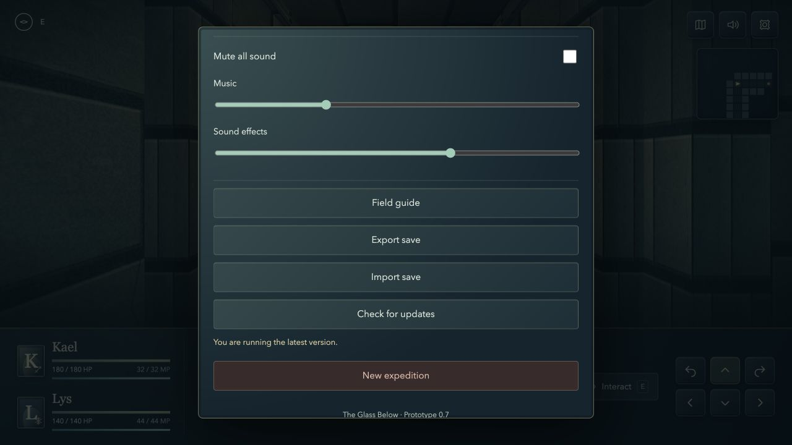

# The Glass Below

An original first-person dungeon RPG for phones, tablets and desktop browsers. TypeScript strict mode, Vite and a small WebGL renderer; no game server, account or telemetry.

## Prototype 0.8

Explore the Glass Crypts, find the copper key, unlock the eastern gate and defeat the Faceless Warden. The hand-built level includes alternative paths, six encounters, a chest, a restorative spring and a final exit. Illustrated creatures stand inside a true 3D environment and are hidden correctly by walls.

Kael and Lys attack automatically. Fracture, Frost Shard and Mending Seal remain manual. Tactical pause freezes combat and lets you queue one skill per hero. Interrupts, freezing and combat speed ×1 / ×2 are supported. Every encounter contains exactly one full-size opponent. Defeating it clears the passage. Three cleared corridors may later receive a returning patrol; these are separate encounters after a four-minute cooldown, never an immediate replacement.

- Three original illustrated creatures, five poses each; their artwork is unchanged.
- Detailed procedural stone, inset floor medallions, projecting plinths and cornices, vault ribs, bronze fittings, animated flame sconces and warm torch lighting against cool shadows.
- Patinated-metal controls, framed minimap and polished combat cards.
- A permanent **Check for updates** menu button reports current, available, offline and error states; activation remains an explicit **Apply update** action.
- Four thin blade-stroke variants, enlarged by 60% with longer visibility and small sparks, plus distinct ice, healing, fracture and enemy-hit effects.
- Individually cropped creature poses and combat framing that keeps the current opponent above a compact enemy-information dock.
- Animated spell particles, damage numbers, hit reactions and camera feedback.
- Eleven original sound effects and three original looping scores: exploration, combat and boss, rendered with FluidSynth and MuseScore General HQ in stereo 48 kHz.
- Global mute, independent music/effect levels, background suspension and iOS-friendly OGG/AAC fallback.
- Fully English interface; level title fades after entry, other notices expire, objectives live in the map/menu.
- Portrait and landscape phone layouts with touch targets of at least 44 px, plus wide tablet/desktop layouts.
- Local versioned saves, validated export/import, and offline PWA after the first complete online visit.

The working title is independent of Hollow Oath. Hollow Oath informed the illustrated style and combat rhythm; Dinosaur Resurrection informed only the exploration perspective. No artwork or music from either game is included.

## Play

[Play The Glass Below](https://girianshiido.github.io/the-glass-below/)

For a self-contained offline copy, open `release/The-Glass-Below.html` in a recent browser. It embeds the artwork and both audio codecs. Sound starts after a user gesture. Installation as a PWA requires an HTTPS deployment.

## Development

Node.js 24 and pnpm 10 are recommended.

```sh
pnpm install --frozen-lockfile
pnpm dev
pnpm test
pnpm build
```

The production build runs strict TypeScript checks, compiles into `dist/`, creates the offline cache and packages the standalone HTML. Browser code is in `src/`; authoring scripts are in `scripts/`. The Python music-rendering script requires numpy, FluidSynth, ffmpeg and a local General MIDI SoundFont; neither is needed to play or build the game normally. All graphics, sound effects and scores are local files.

| Action | Keyboard |
| --- | --- |
| Forward / backward | W or Z / S, or Up / Down |
| Turn left / right | Left / Right |
| Step sideways | A or Q / D |
| Interact | E |
| Map | M |
| Pause / resume | Space |
| Fracture / Frost Shard / Mending Seal | 1 / 2 / 3 |

While paused, selecting a skill queues it; selecting it again cancels it. A new order replaces that hero’s previous order. MP is spent at execution after resuming, with a 0.65-second interval between skills. Combat effects freeze too; the music is ducked. Opening the map or menu pauses combat and does not resume it automatically.

Victory restores 18 HP and 10 MP per hero. The spring fully restores the group once. Retreat preserves current HP and MP but resets undefeated enemies. Saves retain the checkpoint at the start of a fight and update after victory. The original save key and version remain compatible with prototype 0.1; the menu can import its exported saves.

## Returning patrols

The entrance corridor (`first`), central passage (`pair`) and eastern passage (`passage`) can repopulate four minutes after victory, measured in active game time. A site must be at least five tiles away and outside line of sight; only one returning patrol can be present. The boss and the other two encounters never respawn. First-clear progress, the key, the gate and the spring are preserved. A returning patrol grants 10 shards, 6 HP and 4 MP per hero; victory starts a fresh cooldown. Timers and active patrols survive saves and imports. Older saves receive a fresh four-minute grace period.

## GitHub Pages

`.github/workflows/deploy.yml` runs the tests, builds, and deploys `dist/` on pushes to `main`. Pages must use **GitHub Actions** as its source. Relative paths support deployment beneath `/the-glass-below/`. The service worker scopes its cache by URL path and never resets player progress.

## Verification

The 38 automated tests cover world connectivity and gate requirements, a complete expedition, combat pause, queued actions, cooldowns, interrupts, targeting, save validation, transient captions, impact projection, all fifteen creature-frame bounds, full-size framing across phone and desktop sizes, one opponent per encounter, patrol cooldowns, off-screen spawn rules, reduced repeat rewards, legacy-save migration and update-check states, thin impact strokes, codec fallback, music transitions, duplicate playback prevention, mute and background audio handling. Audio assets are also independently probed for valid codecs and duration.

Browser layout checks cover iPhone-sized portrait/landscape views, a large tablet and desktop. Real-device Safari audio behavior, performance and PWA installation still require physical-device checks.

The updated dungeon and interface:





## Original assets

`public/art/bestiary.png` contains five poses for each of three creatures; `src/creature-frames.ts` records their individual crop coordinates. `public/art/impacts.png` provides the ice and healing spell illustrations; physical hits are drawn with Canvas 2D strokes in `src/impact-art.ts`. Original MIDI scores are in `music/`; render them with `python3 scripts/render-soundfont.py` (set `GLASS_SOUNDFONT` if needed). The renderer uses the local MuseScore General HQ bank, preserves settled reverb at the loop boundary, and generates OGG plus AAC. Sound effects retain the synthesis from `scripts/compose-audio.py`; `public/audio/manifest.json` records exact loop durations and audio levels. Architectural textures, lighting, particles and app icons are generated by code.
