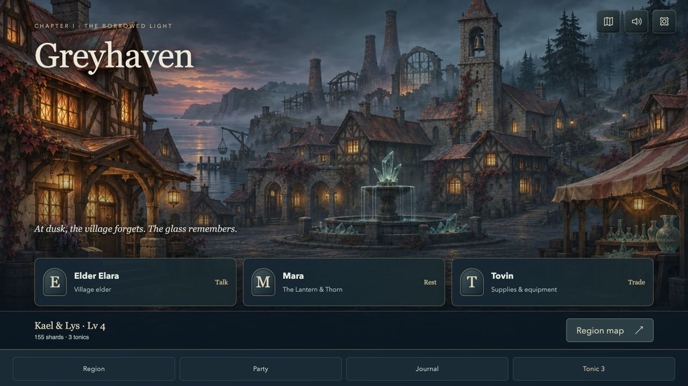

# The Glass Below

An original English-language RPG for phones, tablets and desktop browsers. Strict TypeScript, Vite, WebGL and Canvas 2D. No accounts or game server.

[Play The Glass Below](https://girianshiido.github.io/the-glass-below/)

## Chapter I — The Borrowed Light · 1.0

Kael reaches Greyhaven with a letter he does not remember receiving. The village is losing its memories; the abandoned glassworks may be keeping them.

- An illustrated title screen with **New Game**, **Continue** and **Settings**.
- Kael begins alone. Elara's road commission opens the glassworks investigation; Lys joins through dialogue after the furnace encounter.
- Greyhaven includes Elder Elara, Mara's inn and Tovin's provisions. Dialogue and a journal track the chapter through its final report.
- A regional map links the village, Old Pine Road, the glassworks and the crypts. Village and glassworks use original illustrated scenes; the road and crypts use first-person 3D exploration.
- Shared party XP and levels up to 20. Stats and skill power increase with level; Lys joins at the party's current level. Level-ups fully restore the active party.
- Buy a tempered weapon, protective leather or a frostglass charm. Their attack, HP, defence and spell bonuses are applied in combat. Healing tonics restore 80 HP; the inn restores the party for 5 shards.
- Automatic attacks, manual Fracture, Frost Shard and Mending Seal; tactical pause queues one order per hero, with ×1 / ×2 speed. Spell costs and current power are visible in their descriptions.
- Animated blade strokes, impact ripples, a gathering frost sigil with converging shards, and healing rings with rising motes. Effects freeze with tactical pause and respect reduced motion.
- Six original music loops: title, village, road, crypt exploration, battle and boss. All are rendered with **FluidSynth + MuseScore General HQ**, stereo 48 kHz, in **OGG and AAC**. Eleven sound effects, independent volume levels, global mute and background suspension remain supported.
- A permanent **Check for updates** menu button. A downloaded version is activated only through **Apply update**.

### Start or resume

Choose **New Game** to begin the new story. **Continue** preserves existing saves, including the earlier crypt-only prototype; starting a new journey asks before replacing progress. Save export/import remains available from Settings. All dialogue, progression, equipment, patrols and location state are saved automatically.

The chapter has a complete quest route: clear the road, report to Elara, investigate the furnace, recruit Lys, recover the copper key, open the crypt gate, defeat the Warden and return the memory prism to Greyhaven. The region remains explorable after the ending.



## Returning patrols

Cleared sectors can repopulate after **20 seconds of active play outside the sector and out of sight**. Nearby or visible sites do not spawn a replacement. Each area allows at most one returning patrol, so a distant crypt patrol does not prevent the road from repopulating. The three road sites and three ordinary crypt sites are eligible; the furnace encounter and Warden never return. Returning patrols grant reduced rewards (10 shards, 6 HP and 4 MP each, plus 12 party XP), and never undo quest completion. Pauses, dialogs and backgrounded tabs stop active time.

## Controls

| Action | Keyboard |
| --- | --- |
| Forward / backward | W or Z / S, or Up / Down |
| Turn left / right | Left / Right |
| Step sideways | A or Q / D |
| Interact | E |
| Region map (discovered map in legacy saves) | M |
| Pause / resume combat | Space |
| Fracture / Frost Shard / Mending Seal | 1 / 2 / 3 |

The outdoor road follows a defined path through the forest. Travel between unlocked places is free outside combat. Retreat preserves HP/MP and resets undefeated opponents. Combat saves resume at the encounter checkpoint rather than mid-animation.

## Development

Node.js 24 and pnpm 10 are recommended.

```sh
pnpm install --frozen-lockfile
pnpm dev
pnpm test
pnpm build
```

The build checks TypeScript, produces `dist/`, builds the versioned offline cache and packages `release/The-Glass-Below.html`. The standalone HTML embeds the environment illustrations, creatures and both audio codecs. Installation as a PWA requires HTTPS. Browser storage is versioned and existing prototype saves remain compatible.

- `src/campaign.ts`: chapter state, XP, equipment, quests, travel and outdoor patrol rules.
- `src/chapter-ui.ts` and `src/chapter.css`: dialogue, village, region map, journal and party UI.
- `src/engine.ts`: deterministic world/combat simulation, legacy crypt mode and patrols.
- `src/renderer.ts`: 3D stone architecture and forest geometry, animated creature billboards.
- `src/impact-art.ts` and `src/spell-art.ts`: procedural combat animations.
- `src/save.ts`, `src/audio.ts` and `src/updates.ts`: persistence, Web Audio and explicit updates.

### Music authoring

Editable MIDI scores and render reports are in `music/`. Run `python3 scripts/render-soundfont.py` with numpy, FluidSynth, ffmpeg and a local General MIDI bank. Set `GLASS_SOUNDFONT` to choose another bank; the default is the local MuseScore General HQ used in the neighbouring projects. `GLASS_TRACKS=title,village,road` renders only those scores. The SoundFont itself is not part of the repository. The renderer checks for overlapping notes, renders three passes, extracts a settled loop, bridges the seam and checks decoded OGG/AAC peaks. `public/audio/manifest.json` records sample rates, durations and levels. The original sound-effect synthesis remains in `scripts/compose-audio.py`.

## Verification and deployment

Automated tests cover both the legacy expedition and the complete chapter quest chain, solo/recruited combat, XP and equipment effects, save migration, map constraints, patrol timing/visibility, audio codecs/scene transitions, update checks and creature/effect framing. Browser checks cover desktop, tablet and iPhone-sized portrait/landscape layouts. Physical-device Safari audio, battery use and PWA installation still require on-device checks.

`.github/workflows/deploy.yml` tests, builds and deploys `dist/` on pushes to `main`. GitHub Pages uses GitHub Actions and relative asset paths. Environment illustrations are original generated artwork; the existing creature drawings are unchanged. Hollow Oath informed the illustrated combat style and Dinosaur Resurrection only the exploration perspective; no assets from either game are included.
