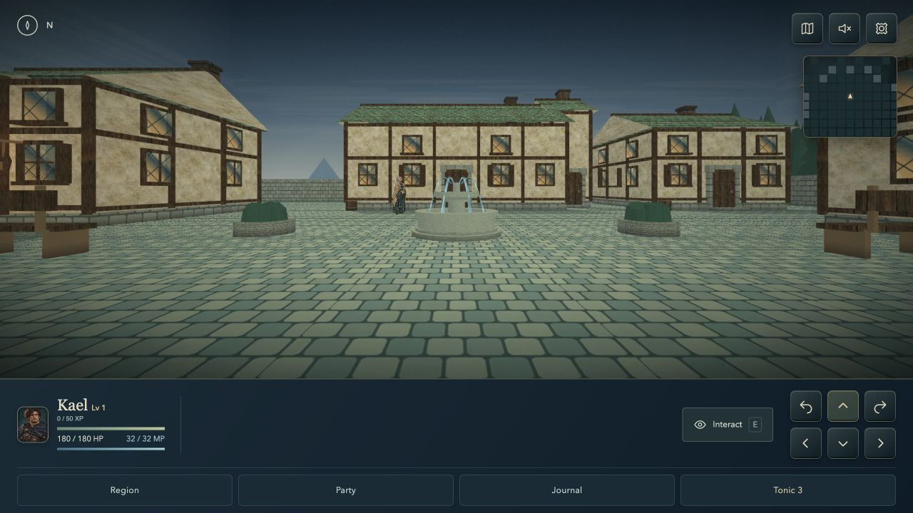
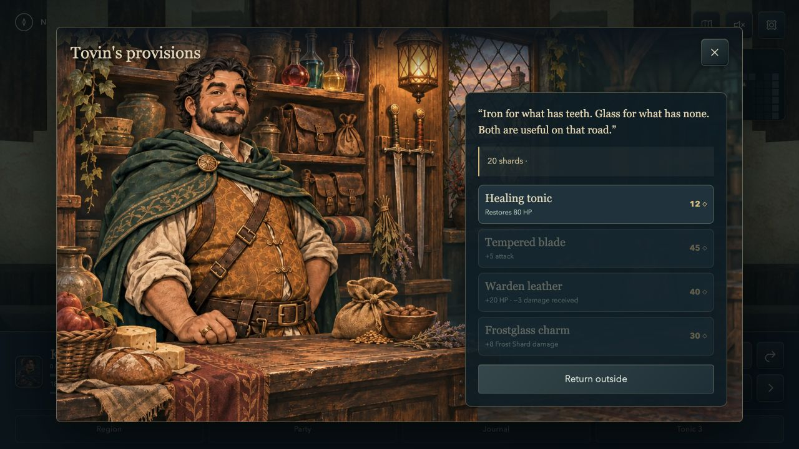
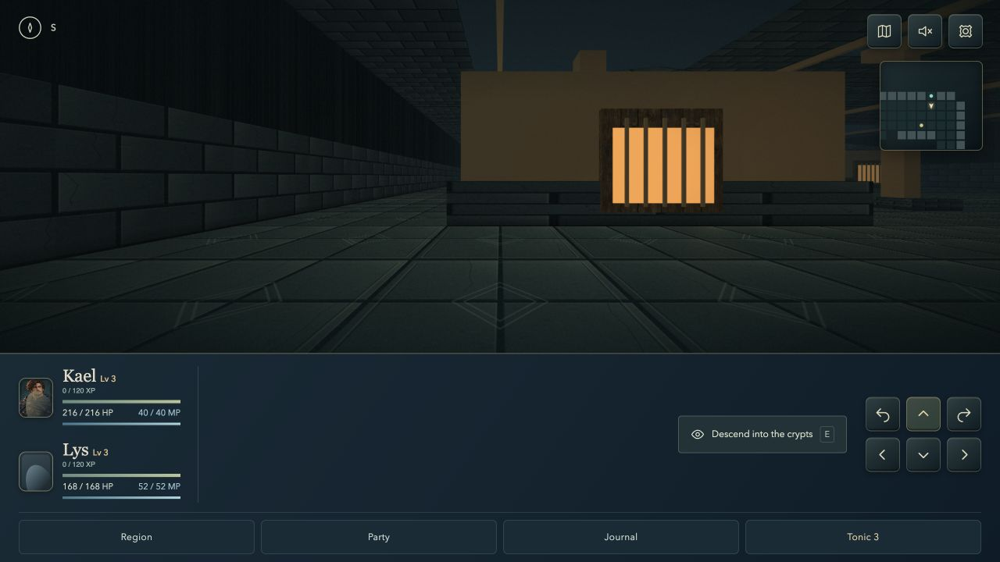

# The Glass Below

An original English-language RPG for phones, tablets and desktop browsers. Strict TypeScript, Vite, WebGL and Canvas 2D. No accounts or game server.

[Play The Glass Below](https://girianshiido.github.io/the-glass-below/)

## Chapter I — The Borrowed Light

Kael reaches Greyhaven with a letter he does not remember receiving. The village is losing its memories; the abandoned glassworks may be keeping them.

- An illustrated title screen with **New Game**, **Continue** and **Settings**.
- Kael begins alone. Elara's road commission opens the glassworks investigation; Lys joins through dialogue after the furnace encounter.
- Greyhaven includes Elder Elara, Mara's inn and Tovin's provisions. Dialogue and a journal track the chapter through its final report.
- Greyhaven, Old Pine Road, the glassworks and the crypts form a connected journey. All four regions use first-person 3D exploration, with distant scenery, broad village squares, forest clearings and large furnace and crypt halls. The compact village has a circular fountain with animated water, benches, planters, textured masonry, glazed windows, brick chimneys and small hanging pictograms. Low mist drifts through the outdoor scene. The trail has soft, uneven earth/grass banks, and tree canopies stay clear of the walkable path. Exterior lighting is fixed in the world; it does not follow the camera. The eastern village gate opens visibly; village and road share one outdoor scene, so walking through the gate has no fade or camera jump. Doors and stairs connect the remaining regions on foot. The regional map is an orientation aid, without fast travel.
- Elara and Lys appear as illustrated full-body characters in the 3D world. Mara and Tovin remain inside their inn and shop: reach their doorstep and walk forward again to open original illustrated interiors with service menus. Leaving returns to the same doorstep. Kael and Lys have portraits in the party interface.
- Shared party XP and levels up to 20. Stats and skill power increase with level; Lys joins at the party's current level. Level-ups fully restore the active party.
- Buy a tempered weapon, protective leather or a frostglass charm. Their attack, HP, defence and spell bonuses are applied in combat. Healing tonics restore 80 HP; the inn restores the party for 5 shards.
- Automatic attacks, manual Fracture, Frost Shard and Mending Seal; tactical pause queues one order per hero, with ×1 / ×2 speed. Spell costs and current power are visible in their descriptions.
- Compact responsive skill buttons show icons, names and MP costs; detailed descriptions and shortcuts remain in tooltips and the party sheet.
- Animated blade strokes, impact ripples, a gathering frost sigil with converging shards, and healing rings with rising motes. Effects freeze with tactical pause and respect reduced motion.
- Seven original music loops: title, village, road, estuary, crypt exploration, battle and boss. All are rendered with **FluidSynth + MuseScore General HQ**, stereo 48 kHz, in **OGG and AAC**. Sixteen sound effects, including six soft, alternating stone/earth footsteps, independent volume levels, global mute and background suspension remain supported.
- A permanent **Check for updates** menu button. A downloaded version is activated only through **Apply update**.

### Start or resume

Choose **New Game** to begin the new story. **Continue** preserves existing saves, including the earlier crypt-only prototype; starting a new journey asks before replacing progress. Save export/import remains available from Settings. All dialogue, progression, equipment, patrols and location state are saved automatically.

The chapter has a complete quest route: clear the road, optionally report to Elara, investigate the furnace, recruit Lys, recover the copper key, open the crypt gate, defeat the Warden and return the memory prism to Greyhaven. The region remains explorable after the ending.







The annealing wing opens off the west side of the glassworks. Recover the courier's ledger **or** light both burners to unlock the kiln stairs once Lys has joined. Doing both opens a service route back to the east side of the hall. Bring the ledger to Elara for a permanent party mana bonus.

## Chapter II — The Drowned Bell

After returning the memory prism, speak to Elder Elara. The old tollgate off Old Pine Road leads to Saltreach, a hamlet linked by causeways, wharves and a bell tower. Meet Neris inside her boathouse. At high water the floating walkway leads to the bonded warehouse, where the freight register records the bell code. At low water the stairhead opens the Drowned Lock, where the code sets the relay and releases the bridge. The culvert can be unbolted from below to connect the two areas at low water. Find and return Neris’s signal lantern for a reward. Unbolt the tower door from inside to open the return route after facing the Keeper. Existing saves retain their equipment, discoveries and story progress.

Lys stays with Kael through the Drowned Lock. The opening of Chapter III includes a solo expedition along the lower quay and Neris joining the party. Her Breakwater halves one incoming strike. Hook Feint deals damage and increases the next Fracture's damage by 50%. The new estuary score is rendered from MIDI with FluidSynth and MuseScore General HQ, in OGG and AAC.

Armoured enemies take reduced damage until Fracture breaks their shell. Some wraiths alternate ordinary attacks and a clearly marked riposte stance. Interrupting a riposte inflicts immediate damage on the caster.

## Returning patrols

Old Pine Road has five initial encounters. Three still count towards Elara's commission. The glassworks has two new threats along its side aisles. Ordinary sites can repopulate after **20 seconds of active play outside the sector and out of sight**. Up to two returning patrols can be active in each campaign area independently. Story encounters stay cleared and returning patrols never undo quest progress. They grant reduced rewards of 10 shards, 12 XP, and 6 HP and 4 MP per active hero.

## Controls

| Action | Keyboard |
| --- | --- |
| Forward / backward | W or Z / S, or Up / Down |
| Turn left / right | Left / Right |
| Step sideways | A or Q / D |
| Interact | E |
| Local discovered map | M |
| Pause / resume combat | Space |
| Active party skills | 1 / 2 / 3 |

The outdoor road is a narrow path with small clearings. Visible monsters engage within reach even from the side, so the road encounters cannot be bypassed. Engaged creatures visibly approach melee distance; impacts and framing follow the approach. There are no invisible random encounters. Walk through the eastern village gate to reach the road, enter the distant glassworks facade, and find the stairs in the north-east corner of its great hall. Ten visible, animated wall torches light the darker crypt. Open handrails leave the entry view clear. The entrance stairs provide a return route; the Warden chamber has another staircase. The Region button provides an overview. Retreat preserves HP/MP and resets undefeated opponents. Combat saves resume at the encounter checkpoint rather than mid-animation.

## Development

Node.js 24 and pnpm 10 are recommended.

```sh
pnpm install --frozen-lockfile
pnpm dev
pnpm test
pnpm build
```

The build checks TypeScript, produces `dist/`, builds the versioned offline cache and packages `release/The-Glass-Below.html`. The standalone HTML embeds the environment illustrations, creatures and both audio codecs. Installation as a PWA requires HTTPS. Browser storage is versioned and existing prototype saves remain compatible. Saves from chapters 1.0 and 2.0 migrate to valid positions in the revised village and narrow woodland trail, preserving progression, equipment and health.

- `src/campaign.ts`: chapter state, XP, equipment, quests, travel and outdoor patrol rules.
- `src/chapter-ui.ts` and `src/chapter.css`: dialogue, region map, journal and party UI.
- `src/engine.ts`: deterministic world/combat simulation, legacy crypt mode and patrols.
- `src/region-world.ts`: two-dimensional region maps, buildings, residents, physical passages and discovery.
- `src/region-geometry.ts`: village architecture, gateposts, trees, furnaces, pillars, staircases and distant landmarks.
- `src/renderer.ts`: textured 3D rendering, gate animation, depth fog and illustrated character billboards.
- `src/impact-art.ts` and `src/spell-art.ts`: procedural combat animations.
- `src/save.ts`, `src/audio.ts` and `src/updates.ts`: persistence, Web Audio and explicit updates.

### Music authoring

Editable MIDI scores and render reports are in `music/`. Run `python3 scripts/render-soundfont.py` with numpy, FluidSynth, ffmpeg and a local General MIDI bank. Set `GLASS_SOUNDFONT` to choose another bank; the default is the local MuseScore General HQ used in the neighbouring projects. `GLASS_TRACKS=title,village,road` renders only those scores. The SoundFont itself is not part of the repository. The renderer checks for overlapping notes, renders three passes, extracts a settled loop, bridges the seam and checks decoded OGG/AAC peaks. `public/audio/manifest.json` records sample rates, durations and levels. The original sound-effect synthesis remains in `scripts/compose-audio.py`. `python3 scripts/render-footsteps.py` renders only the six softer heel-to-toe footsteps, preserving every music master.

## Verification and deployment

Automated tests cover both the legacy expedition and the complete chapter quest chain, solo/recruited combat, XP and equipment effects, save migration, map constraints, patrol timing/visibility, audio codecs/scene transitions, update checks and creature/effect framing. Browser checks cover desktop, tablet and iPhone-sized portrait/landscape layouts. The reproducible local scene launcher at `tests/visual-qa.html` checks the village, kiln stairs and great crypt hall without playing through the entire chapter. Physical-device Safari audio, battery use and PWA installation still require on-device checks.

`.github/workflows/deploy.yml` tests, builds and deploys `dist/` on pushes to `main`. GitHub Pages uses GitHub Actions and relative asset paths. Environment illustrations are original generated artwork; the existing creature drawings are unchanged. Hollow Oath informed the illustrated combat style and Dinosaur Resurrection only the exploration perspective; no assets from either game are included.

Doors and conversations share a 1.35-metre interaction reach, measured from the rendered viewpoint. Advancing towards a resident adds a short approach to speaking distance; one distant grid step no longer opens a shop or a conversation.
